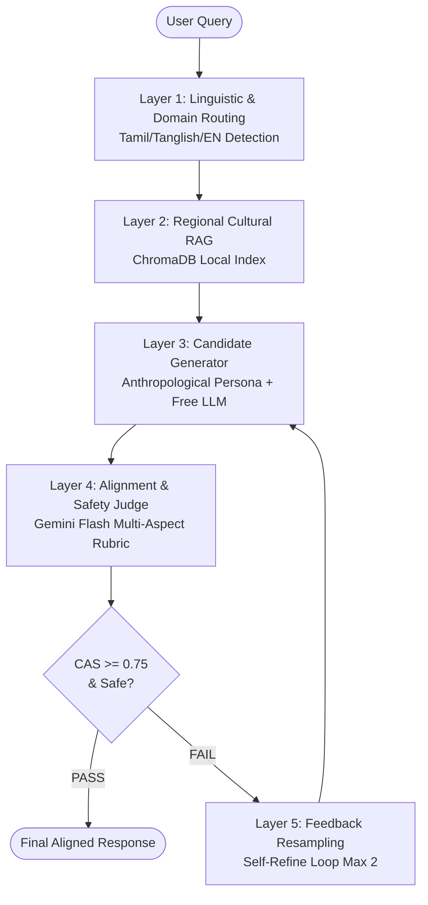

<div align="center">

# 🏛️ Cultural Alignment Layer for Regional LLMs (CAL-LLM)
### *கலாச்சார ஒருங்கிணைப்பு அடுக்கு*

**An open-source, non-invasive operational middleware evaluating, guiding, and adapting LLM responses for regional nuance, socio-cultural appropriateness, and linguistic authenticity across Tamil, Tanglish, and English.**

<p align="center">
  
  
  
  
  
  
</p>

[Architecture](docs/ARCHITECTURE.md) • [Evaluation Rubric](docs/EVALUATION_RUBRIC.md) • [Taxonomy](docs/TAXONOMY.md) • [Roadmap](docs/ROADMAP.md) • [Agent Directives](AGENTS.md)

</div>

---

## ⚡ Executive Summary & Problem Framing

Current multilingual LLMs exhibit linguistic fluency without cultural alignment: they translate sentences accurately into regional Indian languages while defaulting to Western, urban, or North-Indian cultural frames.

```text
Standard Flow: User Query (Tamil/Tanglish) ────> Base LLM ────> Fluent but Misaligned Answer
Proposed Layer: User Query ─> Context RAG ─> Base LLM ─> Evaluator Judge ─> Resampled / Grounded Output
```

**CAL-LLM** is an operational middleware interceptor that inspects prompts, retrieves regional grounding facts, scores the response across cultural dimensions, and resamples or corrects the output when cultural dissonance occurs.

---

## 🎯 Target Benchmarks

- **Win Rate:** $\ge 85\%$ win rate on regional commonsense prompts compared to raw foundation models.
- **Latency:** Sub-2-second end-to-end latency for first-pass accepted answers.
- **Zero Cost:** 100% powered by local vector indexing and free-tier LLM endpoints.

---

## 🔄 Five-Layer Pipeline Flow



---

## 📊 Cultural Alignment Score (CAS) Formula

$$\text{CAS} = 0.30 \cdot C_{\text{understanding}} + 0.35 \cdot S_{\text{appropriateness}} + 0.35 \cdot R_{\text{relevance}} - \text{Penalty}_{\text{risk}}$$

| Dimension | Weight | Target Focus |
|---|---|---|
| **Context Understanding ($C$)** | 30% | Extended family dynamics, situational gravity, household norms |
| **Social Appropriateness ($S$)** | 35% | Honorifics (*vaanga/ponga*), kinship address (*Mama/Chithi*), respectful tone |
| **Regional Relevance ($R$)** | 35% | Tamil Nadu customs, proverbs (*Pazhamozhi*), dietary practices |
| **Domain Risk Penalty** | $-1.0$ | Hard blocker for harmful unscientific advice, caste bias, or stereotypes |

*Full JSON contracts & rubric details: [`docs/EVALUATION_RUBRIC.md`](docs/EVALUATION_RUBRIC.md).*

---

## 🚀 Quickstart

### 1. Environment Setup

```bash
git clone https://github.com/bhargava562/cultural-ai.git
cd cultural-ai

python -m venv .venv
# Windows: .venv\Scripts\Activate.ps1 | Linux/macOS: source .venv/bin/activate
pip install -r requirements.txt
cp .env.example .env
```

### 2. Configure Free API Keys in `.env`

```bash
GROQ_API_KEY="gsk_..."
GEMINI_API_KEY="AIza..."
OPENROUTER_API_KEY="sk-or-..."
```

### 3. Ingest Cultural Knowledge

```bash
# Option A: Ingest curated seed cultural knowledge (instant)
python -m src.retriever.ingest --sample

# Option B: Ingest your own dataset file (.parquet, .jsonl, .csv)
python -m src.retriever.ingest --file data/datasets/tamil_knowledge.jsonl

# Option C: Ingest all datasets uploaded to data/datasets/
python -m src.retriever.ingest --dir data/datasets/
```

### 4. Run the Alignment Interceptor

```bash
python -m src.pipeline.interceptor --query "How should I invite my elder maternal uncle (Mama) for lunch politely?"
```

### 5. Run Offline Tests

```bash
pytest -v tests/
```

---

## 📂 Repository Layout

```text
cultural-ai/
├── docs/                           # Deep domain specifications
│   ├── ARCHITECTURE.md             # 5-layer pipeline architecture & flows
│   ├── EVALUATION_RUBRIC.md        # Alignment dimensions, CAS formula & JSON schema
│   ├── TAXONOMY.md                 # Tamil socio-cultural taxonomy & Hofstede/UNESCO mapping
│   └── ROADMAP.md                  # 4-phase implementation roadmap (Weeks 1-8)
├── data/
│   ├── datasets/                   # Place local dataset files here (.parquet, .jsonl, .csv)
│   ├── raw/                        # Raw chunks
│   └── processed/                  # Processed benchmarks
├── src/
│   ├── retriever/                  # Ingestion (512-tok chunks / 64 overlap) & ChromaDB search
│   ├── pipeline/                   # Generator, Judge, and Interceptor Self-Refine loop
│   ├── utils/                      # Unified LiteLLM wrapper with rate-limit retries
│   └── config.py                   # Central settings & threshold management
├── tests/                          # Offline test suite (mock LLM loops)
├── AGENTS.md                       # Memory checkpoint for AI agent pair-programming
├── CLAUDE.md                       # Developer cheatsheet
└── requirements.txt
```

---

## 📚 Deep Documentation

- 📐 [CAL-LLM Architecture Blueprint](docs/ARCHITECTURE.md)
- 📊 [Evaluation Rubric & CAS Formula](docs/EVALUATION_RUBRIC.md)
- 🌺 [Tamil Socio-Cultural Taxonomy](docs/TAXONOMY.md)
- 🗺️ [Implementation Roadmap](docs/ROADMAP.md)
- 🤖 [Agent Operating Directives](AGENTS.md)

---

## 📄 License

Distributed under the [MIT License](LICENSE).
