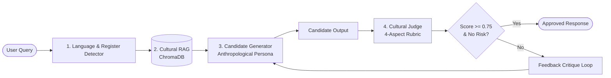

<div align="center">

# 🏛️ Cultural Alignment Layer
### *கலாச்சார ஒருங்கிணைப்பு அடுக்கு*

**An open-source, non-invasive middleware evaluating and adapting LLMs for regional nuance, socio-cultural etiquette, and linguistic authenticity across Tamil, Tanglish, and English.**

<p align="center">
  
  
  
  
  
  
</p>

[Architecture](docs/ARCHITECTURE.md) • [Evaluation Rubric](docs/EVALUATION_RUBRIC.md) • [Taxonomy](docs/TAXONOMY.md) • [Agent Directives](AGENTS.md)

</div>

---

## ⚡ Overview

Foundational frontier models frequently misjudge South Asian cultural hierarchies, honorific registers (*Maryadhai*), kinship terminology, and colloquial code-switching (Tanglish).

The **Cultural Alignment Layer** sits as an intelligent middleware between user queries and LLM outputs, executing a **two-stage feedback loop**:
1. **Context Augmentation:** Retrieves local cultural and linguistic archives via ChromaDB.
2. **Anthropological Steering:** Injects cultural personas and dialect awareness into high-speed generation models.
3. **Multi-Aspect Cultural Judge:** Evaluates candidates across 4 rubric dimensions with strict Pydantic JSON contracts.
4. **Iterative Rewriting:** Intercepts low scores or cultural risks, executing actionable feedback loops.

---

## 🔄 Two-Stage Pipeline Flow



---

## 🎯 The 4 Alignment Dimensions

| Dimension | Weight | Description |
|---|---|---|
| **Context Understanding** | 25% | Grasp of implicit social subtext and situational expectations. |
| **Social Appropriateness** | 35% | Strict honorific alignment (*vaanga/ponga*) and kinship address (*Mama/Chithi*). |
| **Regional Relevance** | 25% | Idiomatic authenticity, local customs, proverbs (*Pazhamozhi*), and culinary traditions. |
| **Stereotype & Risk Flag** | 15% | Hard blocker preventing casteist tropes, gender stereotypes, or linguistic snobbery. |

*Detailed criteria, scoring levels, and validation schemas: [`docs/EVALUATION_RUBRIC.md`](docs/EVALUATION_RUBRIC.md).*

---

## 🚀 Quickstart

### 1. Installation

```bash
git clone https://github.com/bhargava562/cultural-ai.git
cd cultural-ai

python -m venv .venv
# Windows: .venv\Scripts\Activate.ps1 | Linux/macOS: source .venv/bin/activate
pip install -r requirements.txt
cp .env.example .env
```

### 2. Configure Free API Keys in `.env`

```bash
GROQ_API_KEY="gsk_..."
GEMINI_API_KEY="AIza..."
OPENROUTER_API_KEY="sk-or-..."
```

### 3. Ingest Cultural Seed Data

```bash
python -m src.retriever.ingest --sample
```

### 4. Run the Alignment Interceptor

```bash
python -m src.pipeline.interceptor --query "How should I invite my elder maternal uncle (Mama) for lunch politely?"
```

### 5. Run Offline Tests

```bash
pytest -v tests/
```

---

## 📂 Repository Map

```text
cultural-ai/
├── docs/                           # Deep domain documentation
│   ├── ARCHITECTURE.md             # Pipeline specifications & flow diagrams
│   ├── EVALUATION_RUBRIC.md        # Alignment dimensions & JSON schemas
│   └── TAXONOMY.md                 # Tamil socio-cultural taxonomy & Hofstede/UNESCO mapping
├── src/
│   ├── retriever/                  # Local ChromaDB cultural index & search
│   ├── pipeline/                   # Generator, Judge, and Interceptor loops
│   ├── utils/                      # LiteLLM resilient free-tier client wrapper
│   └── config.py                   # Central settings & threshold management
├── tests/                          # Offline test suite (mock LLM loops)
├── AGENTS.md                       # Memory checkpoint for AI agent pair-programming
├── CLAUDE.md                       # Fast commands cheatsheet
└── requirements.txt
```

---

## 📚 Deep Documentation

For full architectural blueprints, taxonomies, and agent prompt guides, refer to:
- 📐 [System Architecture Blueprint](docs/ARCHITECTURE.md)
- 📊 [Evaluation Rubric & Data Contract](docs/EVALUATION_RUBRIC.md)
- 🌺 [Tamil Socio-Cultural Taxonomy](docs/TAXONOMY.md)
- 🤖 [Agent Directives & Vibecoding Rules](AGENTS.md)

---

## 📄 License

Distributed under the [MIT License](LICENSE).
