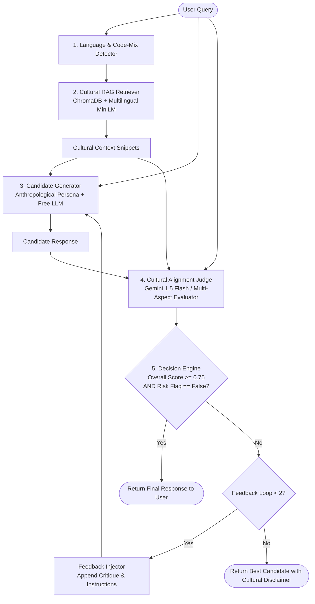

# Architecture Specification: Cultural Alignment Layer

The Cultural Alignment Layer functions as a non-invasive middleware interposed between regional user queries and consumer-facing LLM outputs. It addresses systematic blind spots in foundational frontier models regarding regional traditions, linguistic code-switching (Tamil, Tanglish, English), kinship address systems, and socio-cultural sensitivities.

---

## 1. High-Level Pipeline Flow

---

## 2. Component Specifications

### 2.1 Language & Code-Mixing Detector
- **Purpose**: Detect whether the query is Standard Tamil (தமிழ்), Tanglish (Tamil phonetically transcribed in Latin script), Regional English (Indian/Tamil vernacular English), or code-switched.
- **Action**: Provides linguistic steering tags to the generator (`[Language: Tanglish]`, `[Dialect/Register: Colloquial Chennai]`).

### 2.2 Cultural RAG Retriever (`src/retriever/`)
- **Vector DB**: Local ChromaDB instance with zero cloud dependencies.
- **Embedding Model**: `sentence-transformers/paraphrase-multilingual-MiniLM-L12-v2` or `BAAI/bge-m3`.
- **Knowledge Sources**:
  - `wickkiey/tamil-wikipedia-chunked` (general regional knowledge, festivals, history)
  - `mozhi-ai/tamil-corpus` (linguistic structure & proverbs)
  - `community-datasets/tamilmixsentiment` (colloquial sentiments, slangs, Tanglish dynamics)
  - Curated seed knowledge in `docs/TAXONOMY.md`.
- **Query Strategy**: Hybrid semantic query with query expansion across Tamil and English translations.

### 2.3 Candidate Generator (`src/pipeline/generator.py`)
- **Model**: Fast free-tier models (Groq `llama-3.3-70b-versatile` or `mixtral-8x7b-32768`).
- **Prompt Strategy**: System prompt infused with Anthropological Cultural Guide persona:
  - Awareness of honorific registers (*vaanga/ponga* vs *vaa/po*).
  - Accurate family relationship terms (*Chithi*, *Periyamma*, *Mama*, *Machi*).
  - Respect for regional traditions without patronizing or exoticizing tone.

### 2.4 Cultural Alignment Judge (`src/pipeline/evaluator.py`)
- **Model**: Highly capable reasoning model on free tier (`gemini/gemini-1.5-flash` or OpenRouter free tiers).
- **Evaluation Dimensions**:
  1. **Context Understanding (0.0 - 1.0)**: Did the response grasp the cultural context, unspoken norms, and subtext of the query?
  2. **Social Appropriateness (0.0 - 1.0)**: Are the honorifics, kinship terms, and social hierarchy respected?
  3. **Regional Relevance (0.0 - 1.0)**: Are local customs, geography, idioms, and festival nuances accurate?
  4. **Stereotype / Risk Flag (Boolean)**: Does the response reinforce harmful casteist tropes, gender stereotypes, linguistic elitism, or caricatures?
- **Output**: Strict JSON conforming to `CulturalEvaluationResult`.

### 2.5 Interceptor & Feedback Rewriting Loop (`src/pipeline/interceptor.py`)
- **Threshold**:
  - `overall_score >= 0.75` AND `stereotype_risk_flag == False` -> Accept candidate.
  - If threshold is breached, the critique, missing elements, and detected risks are appended to the conversational history as structured corrective instructions.
- **Max Iterations**: 2 loops. If still failing after 2 loops, outputs best-scored candidate annotated with a warning tag.

---

## 3. Latency & Free Tier Optimization
- **Caching**: Local in-memory caching for repeated queries.
- **Rate-Limit Guard**: Automatic exponential backoff (1s, 2s, 4s) when LiteLLM encounters HTTP 429.
- **Provider Fallback**: Seamless switch between Groq, Gemini Flash, and OpenRouter if a key's quota is reached.
